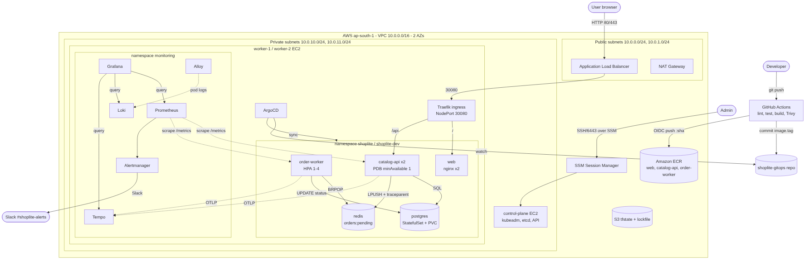

# ShopLite — Build · Ship · Observe · Recover

Capstone for *Mastering DevOps and AWS* (Poridhi, Batch 03, DEVOPS-CAP-601).

ShopLite is a small e-commerce backend: a static **web** UI (nginx), a **catalog-api** (Python/FastAPI),
an **order-worker** that processes orders from a **Redis** queue, and **PostgreSQL**.
It runs on a kubeadm cluster in private subnets on AWS, is deployed by ArgoCD from Git,
and is fully observable with Prometheus, Loki, Tempo and Grafana.



## Quick start (local)

```bash
make test     # unit tests (inside Docker)
make up       # build + start all 5 components, wait for health checks
make smoke    # place an order and wait for COMPLETED
make down
```
Open http://localhost:8080.

## Repository map

| Path | What | Question |
|---|---|---|
| `services/catalog-api` | FastAPI REST API, JSON logs, OTel traces, Prometheus metrics, chaos flags | Q1 |
| `services/order-worker` | Redis consumer, trace continuation, graceful SIGTERM, chaos flags | Q1 |
| `services/web` | Static HTML/JS on unprivileged nginx | Q1 |
| `services/*/Dockerfile`, `docker-compose.yml`, `Makefile`, `scripts/smoke-test.sh` | containers & local stack | Q2 |
| `linux/` | sshd hardening, ACLs, systemd backup timer, UFW, evidence | Q3 |
| `terraform/` (`modules/network, compute, alb, ecr`, `bootstrap/`) | AWS IaC, S3 remote state with locking, budget, GitHub OIDC | Q4 |
| `ansible/` | hardening on every node, containerd, kubeadm, join, kubeconfig | Q4 |
| `helm/shoplite` | single chart: Deployments, StatefulSet, HPA, PDB, NetworkPolicy, Ingress, Job | Q5 |
| `platform/` | Traefik, ArgoCD, metrics-server values | Q5/Q7 |
| `monitoring/` | stack values, dashboards (JSON), PrometheusRules, runbooks | Q6 |
| `.github/workflows` | CI (lint/test/build/Trivy/ECR via OIDC/GitOps bump), Terraform PR plan | Q7 |
| `loadtest/` | k6 script (≥ 20 req/s) | Q8 |
| `docs/` | architecture diagram, RCA template + final RCA, step-by-step guide | all |

GitOps desired state lives in the companion repo **shoplite-gitops**.

## API

| Method | Path | Result |
|---|---|---|
| GET | `/products` | 200, list |
| GET | `/products/{id}` | 200 or 404 |
| POST | `/orders` `{"product_id":1,"quantity":2}` | 201 `{"id":…, "status":"PENDING"}`; 404 unknown product; 422 invalid body |
| GET | `/orders/{id}` | 200 `PENDING / PROCESSING / COMPLETED / FAILED` or 404 |
| GET | `/healthz` | liveness |
| GET | `/readyz` | 200 when DB + Redis reachable, else 503 |
| GET | `/metrics` | Prometheus / OpenMetrics (with exemplars) |

All paths are also reachable under `/api/...` (that is how the browser and the Ingress call them).

## Fault-injection flags (all off by default)

| Variable | Effect |
|---|---|
| `CHAOS_LATENCY_MS` | adds the delay to ~30% of `GET /products/{id}` |
| `CHAOS_ERROR_RATE` | returns 500 for that fraction of `POST /orders` |
| `CHAOS_MEMORY_LEAK` | worker keeps 1 MiB per processed order forever |
| `CHAOS_SLOW_DB` | worker runs `pg_sleep(2)` before each DB update |

In Kubernetes they are set via Helm values `catalogApi.chaos.*` / `orderWorker.chaos.*` in `shoplite-gitops/envs/<env>/values.yaml`.

## Full walkthrough

See **[docs/STEP-BY-STEP.md](docs/STEP-BY-STEP.md)**.
